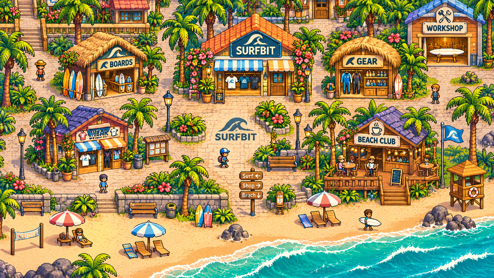
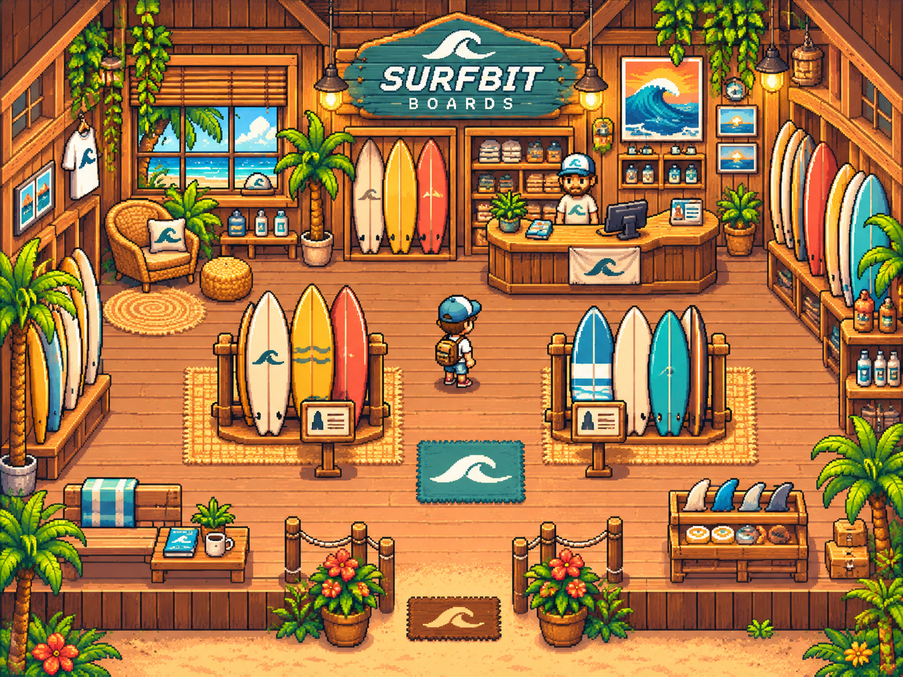
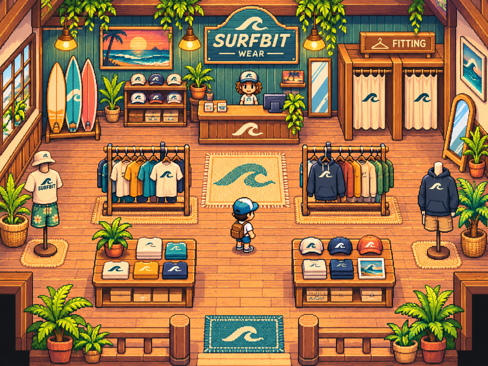

# SURFBIT — Art Direction & UI Guidelines

Every pixel, color and UI element follows this document. If an asset breaks a
rule here, fix the asset, not the rule (or update the rule here first).

## Mood

Relaxed, sunny, nostalgic. A lush tropical surf village in the detail and
density of Stardew Valley: golden sand, deep turquoise water, warm
orange-brown timber, beige cobblestones, dense palms and hibiscus, navy-and-teal
SURFBIT signage, and golden lamp light indoors.

## Visual references

**`docs/art-references/` is the visual target.** When a choice isn't covered
by a rule here, do what the references do. Scene-by-scene layouts, building
specs, product placements and the asset checklist are in
[SCENES.md](SCENES.md).

The images are AI concept art. Match their **composition, palette, detail
density and mood**. Don't trace them pixel for pixel: their perspective is
painterly and their pixel size is uneven. We rebuild them on the 16 × 16 px
grid with 16 × 32 px characters (rules below).

### Style traits to reproduce

- **Saturated and warm.** Every scene leans golden: sand `#fdda8a`, wood
  `#c97a43`, thatch `#f0a14b`. Shadows go warm brown or deep teal, never grey.
- **Density.** No empty ground. Fill the gaps between shops with planters,
  palms, shrubs, flowers, lamps and benches. Interiors have plants, posters,
  rugs and hanging vines in every corner.
- **Readable silhouettes.** Each building has its own roof material and color
  (thatch, terracotta, indigo, slate), a navy sign with the wave mark, and a
  display in the window or front showing what it sells.
- **Selective outlines.** Dark, colored outlines (the darkest shade of each
  ramp) instead of one flat black line around everything. Characters keep a
  full `#2b2433` outline so they stay readable.
- **Soft top-left light**, with chunky 2–3-shade ramps per material. Interiors
  get warm pools of light under pendant lamps.
- **Brand everywhere.** Wave mark on signs, rugs, mats, tees, curtains,
  flags and the plaza inlay (SCENES.md → Brand mark).

Before marking any visual roadmap step done, take a screenshot of the scene
and compare it side by side with its reference. Mention the main remaining
differences in your summary.

### Beach Town

Use the central plaza as a landmark with clear paths to the shops, the stone
stairs and the beach. Give each storefront a readable sign and a display that
identifies what it sells. Group palms, flowers, and benches along the paths so
the routes stay legible. Layout: [SCENES.md → Beach town](SCENES.md#1-beach-town-town).

### Boards interior

Make upright surfboards the focal point. Use warm timber and surf posters to
give the room character, and keep a clear aisle from the entrance to the
displays and counter. Layout: [SCENES.md → Boards interior](SCENES.md#2-boards-interior-boards).

### Wear interior

Pair teal walls with warm wood. Place clothing racks and mannequins along the
main aisle, and make the fitting rooms easy to spot from the entrance.
Layout: [SCENES.md → Wear interior](SCENES.md#3-wear-interior-wear).

### Gear interior

Follow the [Gear scene brief](SCENES.md#4-gear-interior-gear) and the shared
look of the Boards and Wear interiors. Consult the owner before expanding
the layout beyond that brief while there is no Gear concept image.

## Palette

One palette for the whole project. **UI tokens** live in
`src/app/globals.css` (`--sb-*`); **game colors** live in
`src/game/art/palette.ts` (`P.*`). Shared colors must have the same hex in both.

World colors are sampled from the reference images. Display colors also use
the mock catalog's product artwork. The Aseprite/GIMP version of the
palette is `assets/palette/surfbit.gpl`; regenerate it from `palette.ts` when
colors change.

### Brand

| Name | Hex | CSS token | `P.` key | Use |
|---|---|---|---|---|
| Navy | `#114f6d` | `--sb-navy` | `navy` | Logo, wordmark, sign boards, headings |
| Navy Dark | `#0c3b56` | `--sb-navy-dark` | `navyDark` | Sign shadows, pressed states |
| Sign Teal | `#3d7a74` | `--sb-sign-teal` | `signTeal` | Wave mats, counter marks, plaza inlay |
| Sign Teal Dark | `#194e56` | `--sb-sign-teal-dark` | `signTealDark` | Sign borders |
| Coral | `#e8734a` | `--sb-coral` | `coral` | Primary accent, CTAs, Boards shop |
| Coral Dark | `#c4553a` | `--sb-coral-dark` | `coralDark` | Hover / pressed, danger |
| Teal | `#3c8c84` | `--sb-teal` | `teal` | Wear shop, success |
| Teal Dark | `#2c6f6a` | `--sb-teal-dark` | `tealDark` | Hover |
| Sun | `#f2b632` | `--sb-sun` | `sun` | Gear shop, highlights, warnings |
| Sun Dark | `#d18f1d` | `--sb-sun-dark` | `sunDark` | Hover |
| Sky | `#6fccd2` | `--sb-sky` | `sky` | Sky in windows, cool accents |
| Deep Blue | `#2f6f8f` | `--sb-deep-blue` | `deepBlue` | Focus rings |
| Flag Blue | `#1684c6` | — | `flagBlue` | SURFBIT flags, blue awnings |
| Cream | `#fff3d6` | `--sb-cream` | `cream` | Page background, light fills, sign lettering |

### Terrain

| Name | Hex | `P.` key | Use |
|---|---|---|---|
| Sand / Light / Dark | `#fdda8a` / `#fee9b0` / `#e9bf6e` | `sand*` | Beach |
| Wet sand / Dark | `#d9b071` / `#a7906f` | `sandWet*` | Shoreline, footprints |
| Water / Light / Deep / Deeper | `#0fb0bc` / `#37c0c6` / `#02919f` / `#017a8a` | `water*` | Ocean |
| Foam / Shade | `#fcfbf0` / `#bfe6e0` | `foam*` | Wave crests, swash |
| Cobblestone / Light / Dark | `#ecbe78` / `#fad5a0` / `#cba260` | `stone*` | Streets, plaza |
| Grout | `#7a6a45` | `grout` | Gaps between cobbles |
| Wall stone / Light / Dark | `#ba9780` / `#eec898` / `#7c745f` | `wallStone*` | Retaining walls, planters, stairs |
| Rock / Dark / Deep | `#a58174` / `#6e5b5f` / `#3f3948` | `rock*` | Beach rocks |
| Grass / Light / Dark / Deep | `#6f9e3c` / `#a2a042` / `#3a6b36` / `#143e34` | `grass*` | Garden beds (sparingly) |

### Materials

| Name | Hex | `P.` key | Use |
|---|---|---|---|
| Wood / Light / Dark / Deep | `#c97a43` / `#e79b5b` / `#8a4a26` / `#552f26` | `wood*` | Floors, decks, furniture, walls |
| Thatch / Light / Dark / Deep | `#f0a14b` / `#fcca6e` / `#b97e51` / `#6c4738` | `thatch*` | Boards and Gear roofs |
| Terracotta / Light / Dark | `#e45f2a` / `#f08a55` / `#b3461f` | `terracotta*` | SURFBIT Goods roof, cottages |
| Indigo roof / Dark / Deep | `#6a6796` / `#524f8f` / `#232f4c` | `roofIndigo*` | Wear and Beach Club roofs |
| Slate roof / Dark | `#8791ba` / `#6c5a69` | `roofSlate*` | Workshop roof |
| Sage wall / Dark | `#577559` / `#234144` | `wallSage*` | Wear interior back wall |
| Iron / Dark | `#4f565c` / `#171e2a` | `iron*` | Street lamps, racks |
| Glow / Warm | `#fdf2ad` / `#e4ab3f` | `glow*` | Lamp light, windows at dusk |

### Product displays

| Name | Hex | CSS token | `P.` key |
|---|---|---|---|
| Product teal | `#3fa7a0` | `--sb-product-teal` | `productTeal` |
| Parchment | `#f6e7c1` | `--sb-parchment` | `parchment` |
| Fin brown | `#7a4b2a` | `--sb-fin-brown` | `finBrown` |
| Fish blue | `#7bc6e8` | `--sb-fish-blue` | `fishBlue` |
| Foam lime | `#c9e86b` | `--sb-foam-lime` | `foamLime` |
| Gear charcoal | `#2b2b3a` | `--sb-gear-charcoal` | `gearCharcoal` |
| Bag silver | `#c8ccd4` | `--sb-bag-silver` | `bagSilver` |

### Foliage

| Name | Hex | `P.` key | Use |
|---|---|---|---|
| Leaf / Light / Glint | `#4f8a3a` / `#a2a042` / `#e0d13c` | `leaf*` | Palms, shrubs (light = sunlit tips) |
| Leaf Dark / Deep | `#2b5e36` / `#143e34` | `leafDark`, `leafDeep` | Shaded leaves, outlines |
| Trunk / Dark | `#a8754a` / `#7c5132` | `trunk*` | Palm trunks |
| Hibiscus / Pink / Lilac | `#e8505b` / `#f29bb0` / `#a99be0` | `hibiscus`, `pink`, `lilac` | Flowers |

### Neutrals

| Name | Hex | Use |
|---|---|---|
| Outline | `#2b2433` | 1px sprite outlines, UI borders, hard shadows |
| Ink | `#3d3346` | Body text, dark details |
| Muted | `#7a6e80` | Secondary text |
| White | `#ffffff` | Panels, product UI surfaces |

Skin tones: `#f5cfa6`, `#d9a173`, `#a86f48`, `#6e4430` (`P.skin1..4`). NPCs
should use a mix.

**Never use pure black.** Darkest color is Outline `#2b2433`.

## Pixel rules

| Rule | Value |
|---|---|
| Tile size | **16 × 16 px** |
| Character frame | **16 × 32 px**, chibi proportions (head ≈ 40% of height), feet at the bottom |
| Character sheet | 3 columns × 4 rows = `[stand, stepA, stepB]` × `[down, left, right, up]` |
| Outline | Characters: full 1px `#2b2433` outline (`autoOutline`). Environment and props: selective outline using the darkest shade of each material's ramp |
| Light source | Top-left, warm; shade the bottom/right edges with warm browns or deep teal |
| Perspective | Three-quarter (top-down with visible front faces) — buildings show a roof + front wall |
| Rendering | `pixelArt: true`, `roundPixels: true`, `image-rendering: pixelated` |
| Zoom | **Integer only** (2×, 3×, 4×). Never non-integer scale pixel art |
| Rotation | **Never rotate pixel sprites.** Use extra frames for sway/wobble |
| Gradients | None in sprites. Light glows are the only exception (additive, low alpha) |
| Text in world | 3×5 pixel font (`src/game/art/font.ts`), uppercase |

### Size reference

| Thing | Size (px) | Footprint (tiles) |
|---|---|---|
| Player / NPC | 16 × 32 | 1 × 1 at the feet |
| Palm | 48 × 64 | 1 × 1 (trunk) |
| Umbrella | 32 × 44 | non-solid |
| Shop (Boards, Gear, Wear) | 144 × 112 (9 × 7 tiles, roof included) | full rect except door |
| Flagship | 192 × 128 (12 × 8 tiles) | full rect except door |
| Beach Club | 192 × 112 (12 × 7 tiles) | full rect except door, plus a walkable deck |
| Cottage | 112 × 96 (7 × 6 tiles) | full rect except door |
| Interior room | ~20 × 14 tiles, back wall 3 tiles tall | — |
| Surfboard display | 14 × 48 | 1 × 1 |
| Counter | 48 × 28 | 3 × 1 |

Full scene layouts: [SCENES.md](SCENES.md).

### Animation timing

| Animation | Frames | Timing |
|---|---|---|
| Walk | stand, A, stand, B | 8 fps (×1.5 when running) |
| Water / foam tiles | 4 | 300 ms per frame |
| Shore overlay (swash, surf lines) | 4 | 300 ms, in step with the water |
| Palm sway | 3 (ping-pong) | ~450 ms per frame, randomised start |
| Flags | 3 | 160 ms per frame |
| Gulls | 2 | 200 ms per frame |
| Lamp flicker | alpha tween | 0.75–1.0, irregular |
| Footprints | — | fade over 2.5 s |

**Reduced motion** (OS setting or in-game toggle): no gulls, sway,
flicker or camera fades. Water tiles and the shore overlay still animate at
¼ speed. Walking
animation stays (it is feedback, not decoration).

## Production art

The generators in `src/game/art/*` started as placeholders and become
production art as each asset group is finished in Phase A (ARCHITECTURE.md →
D14). The full list is in [SCENES.md → Asset checklist](SCENES.md#7-asset-checklist-production-art).
Aim for a bolder pixel look than the references with fewer colors per sprite,
cleaner shapes and less tiny detail. The
A.3 slice set the standard: rounded cobbles with grout and a top-left bevel,
water with ripple bands and lacy two-line foam, palms with layered fronds
and a ringed trunk, thatch laid in staggered courses with a shaggy eave, open
shop fronts with a lit interior, and characters with a shaded far edge. All
art must follow the palette and pixel rules in this file, and any
third-party art must be listed in `assets/LICENSES.md`. Never drop a reference image straight into the game: it isn't on a pixel
grid, it can't be split into layers, and it blurs when zoomed.

### Replacing placeholder art with real assets

Edit static art in `src/game/art/`. For map-specific variants, edit the
building design, NPC look or prop tint in the map definition. Run
`npm run art:export` to regenerate the files in `public/assets/world/`. The
command uses Chrome by default. Set `SURFBIT_CHROMIUM` to the path to a
Chromium executable if needed.

The exporter packs complete sprite sheets in one PNG/JSON atlas per map.
BootScene loads `town.png` and `town.json`, which also hold the player,
shadow and interaction marker. The shops load their own atlases on entry
and reuse any sheets already registered by the town. Registration restores
the texture keys and numbered animation frames. The shared `tiles.png` uses
the order defined by `TILE_NAMES`. The current map's coastline determines the
shoreline overlay at runtime.

For hand-drawn additions, work at 1× in Pixelorama, LibreSprite or Aseprite
using `assets/palette/surfbit.gpl`. Keep the existing texture key, frame size
and order when replacing a sheet in the export.

## UI language

Two layers with different jobs:

- **Game chrome** (HUD buttons, prompt pill, dialog box, directory): retro.
  Chunky 3px `Outline` border, 4px hard shadow (`.sb-panel`, `.sb-btn`),
  pixel font for short labels.
- **Commerce UI** (product modal, cart, checkout, /shop): retro *frame*,
  modern *content*. Same border/shadow, but text in Inter, generous spacing,
  real form controls, clear prices.

### Typography

| Use | Font | Size |
|---|---|---|
| HUD labels, prompt pill, section titles | Press Start 2P (`--sb-font-pixel`) | 10–16 px, max ~3 words |
| Everything else (descriptions, prices, forms, checkout) | Inter (`--sb-font-body`) | ≥ 16 px body, ≥ 14 px secondary |

Never set paragraphs, prices or form labels in the pixel font.
Use the [SVG wordmark](SCENES.md#6-brand-mark) in the HUD and storefront header.

### Components

| Component | Spec |
|---|---|
| Button | `.sb-btn` — Coral fill, Outline text, 3px outline, 2px hard shadow, press = translate(2px,2px) + no shadow. Secondary = `.sb-btn--secondary` |
| Panel | `.sb-panel` — white, 3px outline, 6px radius, 4px hard shadow |
| Joystick | Navy base with a cream thumb at bottom left on coarse pointers |
| Prompt pill | Bottom-center with the **E** keycap on desktop. Bottom-right with a tappable **A** on coarse pointers. |
| Dialog box | Bottom of screen, name tag in pixel font, text in Inter, ▼ indicator to advance |
| Product modal | Centered panel (full-screen sheet on mobile): image left / details right on desktop, stacked on mobile |
| Cart | Right drawer (bottom sheet on mobile) |

### Accessibility

- Text contrast ≥ 4.5:1. Outline on Coral is 4.98:1. Primary button hover uses
  White on a blend of Coral Dark and Outline at 5.04:1. Use Muted on White
  for secondary text and Ink on Cream.
- Every interactive element reachable by keyboard with a visible focus ring
  (`--sb-focus`). Use Cream and Outline together over the game canvas.
- Modals trap focus, close on `Esc`, return focus to the canvas.
- Announce location and contextual prompt changes with polite live regions.
- Touch targets ≥ 44 × 44 px.
- Every product reachable without the game (`/shop`, `/products/[handle]`).
